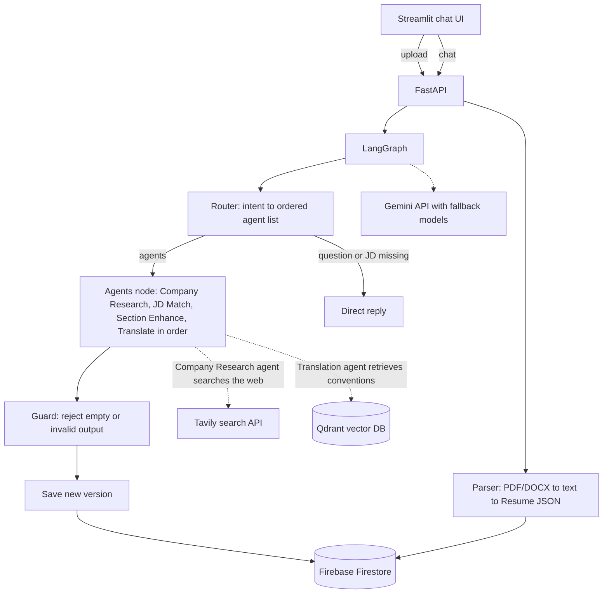

# Conversational Resume Optimization System

Chat with your resume. Upload a PDF/DOCX, then ask things like "Optimize my resume for Google", "Translate this to Spanish for the Mexican market" or "Make my skills section more relevant for a data scientist role". A router sends each message to the right agent(s), every change is saved as a version in Firebase, and you can undo, redo and compare versions.

## Implemented agents (all 4)
1. **Company Research & Optimization Agent**: researches the target company on the web (Tavily search API: culture, values, hiring patterns) and adjusts the language and emphasis of the resume to match. Cites the sources it used.
2. **JD Matching Agent**: analyzes a job description (or a target role), gives a match score (0-100), lists skill gaps, and restructures the resume to highlight relevant experience.
3. **Section Enhancement Agent**: improves a requested section with action verbs, impact statements and consistent style.
4. **Translation & Localization Agent**: translates the resume and adapts tone and date formats to the target market. It retrieves local hiring conventions from a Qdrant vector database (RAG) before translating.

## Architecture

Flow of one chat message:
1. Message, last messages of history and the active resume version are loaded from Firestore.
2. The **router** returns structured output (agents in order, target section, language, market, company, role, needs_jd).
3. Agents run **sequentially**, each receiving the output resume of the previous one (this is how multi-agent requests like "strengthen my summary, then translate to French" work). Order: company research, JD match, section enhancement, translation (always last).
4. A guard rejects an agent output if it dropped content (empty name or experience).
5. The result is saved as a new version; the UI shows reasoning, changes, match score, skill gaps and web sources.

## Code components
| File | Purpose |
|---|---|
| `backend/main.py` | FastAPI endpoints: `/upload`, `/chat`, `/versions/{id}`, `/versions/{id}/restore/{v}`, `/messages/{id}` |
| `backend/graph.py` | LangGraph orchestration (route, agents, save) and `run_chat` |
| `backend/router.py` | Intent router (LLM structured output + keyword fallback) |
| `backend/parser.py` | PDF (PyMuPDF) / DOCX (python-docx) text extraction and conversion to structured Resume JSON |
| `backend/agents/` | `company_research.py`, `jd_match.py`, `section_enhance.py`, `translate.py`, shared `base.py` (rules + structured output) |
| `backend/knowledge.py` | Qdrant vector DB (BGE embeddings) with local hiring conventions; `search_conventions()` used by the Translation agent |
| `backend/firebase_db.py` | Firestore: conversations, messages, versions, active version |
| `backend/llm.py` | Gemini client with retries and fallback across models |
| `backend/schemas.py` | Pydantic models (Resume, RouterDecision, AgentResult) |
| `frontend/app.py` | Streamlit chat UI: upload, chat, agent reasoning, current resume, undo/redo, version diff |

## Context engineering choices
- **Structured resume state**: the resume is parsed once into JSON (summary, experience, skills, projects, education...). Agents edit sections, not raw text, which makes diffs, versioning and section-level edits reliable.
- **Minimal context per agent**: agents receive only the current resume JSON, the task and the target (JD/company/role/section/language). They do not receive chat history, which keeps cost and noise low.
- **Retrieved context, not static prompts**: the Company Research agent receives short snippets of fresh web results (top sources, truncated), and the Translation agent gets only the 2 most relevant market conventions from Qdrant.
- **Router gets conversation context**: only the last few messages plus whether a JD was provided, enough to resolve follow-ups.
- **Truthfulness rules in every agent prompt**: never invent employers, dates, metrics or skills; never change job titles, companies, degrees or contact details (except when translating); if a metric is missing, say what the user could add.
- **State management**: every change creates an immutable version in Firestore with note and agent name; an `active_version` pointer enables undo/redo and compare.
- **Validation**: Pydantic structured output for router and agents; a guard rejects outputs that lose core content.
- **Reliability**: retries and automatic fallback across Gemini models (free tier returns 503 under load); if web search is unavailable, the Company Research agent says so in its reasoning instead of guessing.

## Tools, APIs and why
- **LangChain + LangGraph**: LangChain (`langchain-google-genai`, structured output with Pydantic) for LLM calls, LangGraph for the routing and multi-agent workflow graph.
- **FastAPI**: clean chat API design, typed request/response.
- **Firebase Firestore**: required; stores messages and resume versions.
- **Gemini API (free tier)**: chosen to keep the whole project free; model configured through `GEMINI_MODEL`.
- **Tavily search API (free tier)**: web research for the Company Research agent (culture, values, hiring patterns), returns clean text snippets and URLs.
- **Qdrant (vector DB) + BGE embeddings (fastembed)**: stores local hiring conventions per market (Mexico, Spain, France, Germany, Brazil, USA, UK, India). The Translation agent retrieves the most relevant ones (RAG) before translating.
- **PyMuPDF / python-docx**: