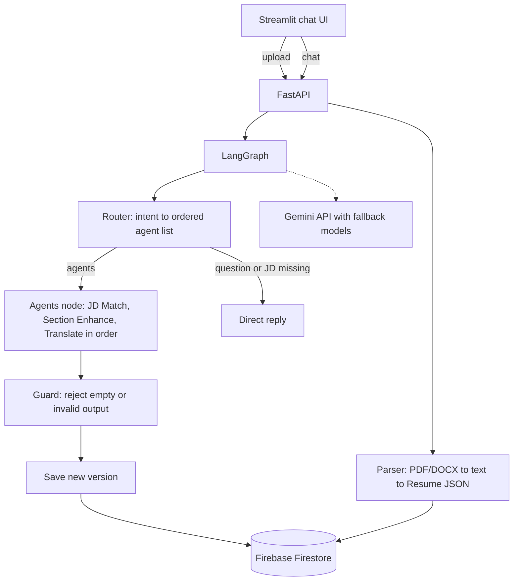

# Conversational Resume Optimization System

Chat with your resume. Upload a PDF/DOCX, then ask things like "Optimize my resume for Google", "Translate this to Spanish for the Mexican market" or "Make my skills section more relevant for a data scientist role". A router sends each message to the right agent(s), every change is saved as a version in Firebase, and you can undo, redo and compare versions.

## Implemented agents (3 of 4)
1. **JD Matching Agent**: analyzes a job description (or a target company/role), gives a match score (0-100), lists skill gaps, and restructures the resume to highlight relevant experience.
2. **Section Enhancement Agent**: improves a requested section with action verbs, impact statements and consistent style.
3. **Translation & Localization Agent**: translates and adapts headings, tone and date formats to the target market.

The Company Research agent is not implemented (web research was out of scope for the 24-hour limit).

## Architecture

Flow of one chat message:
1. Message, last messages of history and the active resume version are loaded from Firestore.
2. The **router** returns structured output (agents in order, target section, language, market, company, role, needs_jd).
3. Agents run **sequentially**, each